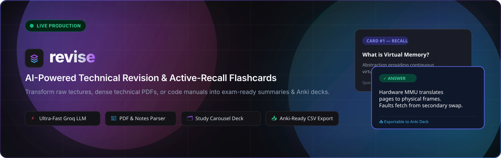
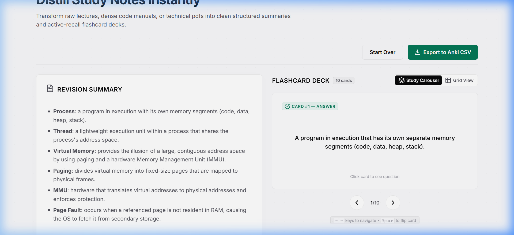
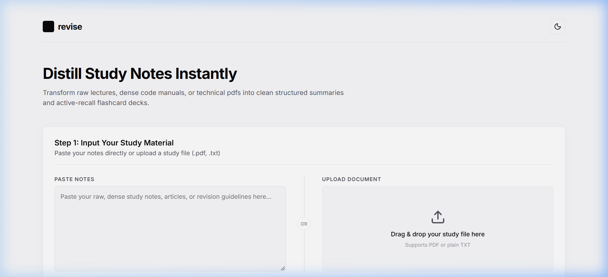
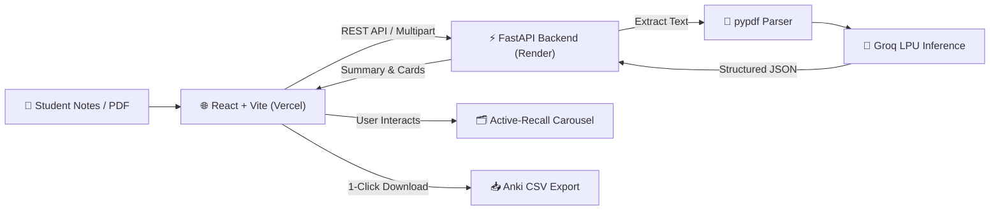

<p align="center">
  
</p>

<p align="center">
  <a href="https://revise-nu-neon.vercel.app/" target="_blank">
    
  </a>
  <a href="https://revise-api-d31y.onrender.com/health" target="_blank">
    
  </a>
  <a href="https://github.com/KalagiPandya/Revise" target="_blank">
    
  </a>
  <a href="https://github.com/KalagiPandya/Revise" target="_blank">
    
  </a>
  <a href="https://groq.com/" target="_blank">
    
  </a>
  <a href="https://github.com/KalagiPandya/Revise/blob/main/LICENSE" target="_blank">
    
  </a>
</p>

---

## 🌟 Overview

**Revise** is an exam-oriented full-stack web application designed for students and engineers revising dense technical material (*Operating Systems, DBMS, Distributed Systems, Computer Networks, and System Design*).

Simply paste lecture notes or drop a `.pdf`/`.txt` document to instantly receive:
1. 📝 **Structured Markdown Revision Summary:** Core definitions, architecture mechanics, formulas, and key trade-offs.
2. 🗂️ **Interactive Active-Recall Flashcard Deck:** 10–15 testable question/answer pairs covering definitions, comparisons, and mechanics.
3. 📥 **1-Click Anki Deck CSV Export:** Pre-formatted two-column CSV directly importable into the **Anki** desktop & mobile app.

👉 **Experience the live app:** [https://revise-nu-neon.vercel.app/](https://revise-nu-neon.vercel.app/)

---

## 📸 Production Preview

<p align="center">
  
</p>

<details>
  <summary><b>🔍 View Landing & Document Upload Screen</b></summary>
  <br/>
  <p align="center">
    
  </p>
</details>

---

## ✨ Key Features

| Feature | Description |
| :--- | :--- |
| **⚡ Instant LPU Inference** | Powered by Groq's high-throughput LPU running state-of-the-art models for near-instant distillation. |
| **📑 Dual Input Modes** | Accepts raw pasted notes (with live character counter up to 15,000 chars) or drag-and-drop `.pdf` and `.txt` files. |
| **🗂️ Active-Recall Study Carousel** | Flip cards with 3D animation to test yourself before viewing answers; smooth keyboard navigation. |
| **🎛️ Dual-Mode Deck Viewer** | Toggle between a focused **Study Carousel** (one card at a time) and an overview **Grid View** (all cards visible). |
| **📥 Anki-Ready CSV Export** | Generates compliant RFC-4180 escaped CSV streams for direct import into Anki (Column 1 $\rightarrow$ Front, Column 2 $\rightarrow$ Back). |
| **🌓 Adaptive Glassmorphism UI** | Sleek theme switcher (Dark / Light) with custom dot-matrix grid and minimalist typography. |
| **🛡️ Resilient Architecture** | Multi-tier model fallbacks (`gpt-oss-120b`, `qwen3.8-27b`), exponential retry backoff, and CORS-hardened endpoints. |

---

## 🔄 System Architecture Flow



---

## ⌨️ Study Keyboard Shortcuts

When studying in **Study Carousel** mode, you can review cards without touching your mouse:

| Key | Action |
| :---: | :--- |
| <kbd>Space</kbd> | **Flip Card** (Reveal Answer $\leftrightarrow$ Question) |
| <kbd>→</kbd> | **Next Card** in Deck |
| <kbd>←</kbd> | **Previous Card** in Deck |

---

## 🛠️ Tech Stack

### Frontend
- **Framework:** React 19 (Vite 8)
- **Styling:** Vanilla CSS (Glassmorphism design tokens, CSS variables, dark/light themes)
- **Icons:** Lucide React
- **Hosting:** [Vercel](https://vercel.com/)

### Backend
- **Framework:** FastAPI (Python 3.11+)
- **ASGI Server:** Uvicorn
- **Document Extraction:** `pypdf`
- **Validation:** Pydantic v2
- **Hosting:** [Render](https://render.com/)

### AI / LLM Engine
- **Provider:** [Groq Cloud](https://console.groq.com/)
- **Inference Models:** `openai/gpt-oss-120b` (Primary) $\rightarrow$ `qwen/qwen3.8-27b` (Fallback)
- **Mode:** Structured JSON Output

---

## 🚀 Running Locally

### 1. Prerequisites
- **Python:** 3.11+
- **Node.js:** v18+ and `npm`
- **Groq API Key:** Free at [console.groq.com](https://console.groq.com/)

### 2. Backend Setup
```bash
# 1. Navigate to backend
cd backend

# 2. Create and activate virtual environment
# Windows:
python -m venv .venv
.venv\Scripts\activate
# macOS/Linux:
python3 -m venv .venv
source .venv/bin/activate

# 3. Install dependencies
pip install -r requirements.txt

# 4. Set your Groq API Key
# Create a .env file inside backend/ or set via terminal:
# Windows (PowerShell):
$env:GROQ_API_KEY="gsk_your_api_key_here"
# Linux/macOS:
export GROQ_API_KEY="gsk_your_api_key_here"

# 5. Start the backend server
uvicorn main:app --reload --port 8000
```
API server runs at `http://127.0.0.1:8000` (Interactive docs at `http://127.0.0.1:8000/docs`).

### 3. Frontend Setup
```bash
# 1. Open a new terminal and navigate to frontend
cd frontend

# 2. Install dependencies
npm install

# 3. Start Vite dev server
npm run dev
```
Open your browser at `http://localhost:5173`.

---

## 🚢 Production Deployment

| Service | Platform | Live URL | Configuration |
| :--- | :---: | :--- | :--- |
| **Frontend** | **Vercel** | [revise-nu-neon.vercel.app](https://revise-nu-neon.vercel.app/) | Root: `frontend`, Env: `VITE_API_URL` |
| **Backend** | **Render** | [revise-api-d31y.onrender.com](https://revise-api-d31y.onrender.com) | Root: `backend`, Env: `GROQ_API_KEY` |

---

## 📥 How to Import into Anki

1. In the app, click **"Export to Anki CSV"** after generating your deck.
2. Open the desktop **Anki** application.
3. Click **File** $\rightarrow$ **Import...** and select `revise-flashcards.csv`.
4. Ensure:
   - **Field Separator:** Comma (`,`)
   - **Field 1:** mapped to **Front**
   - **Field 2:** mapped to **Back**
5. Click **Import** — your testable deck is ready for spaced repetition review!

---

## 👩‍💻 Author

**Kalagi Pandya**  
- **GitHub:** [@KalagiPandya](https://github.com/KalagiPandya)  
- **Institution:** Dhirubhai Ambani Institute of Information and Communication Technology (DA-IICT)

---

<p align="center">
  <sub>Built with ❤️ for focused, high-speed revision.</sub>
</p>
